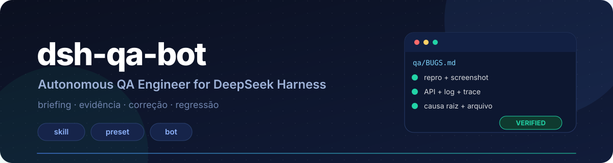
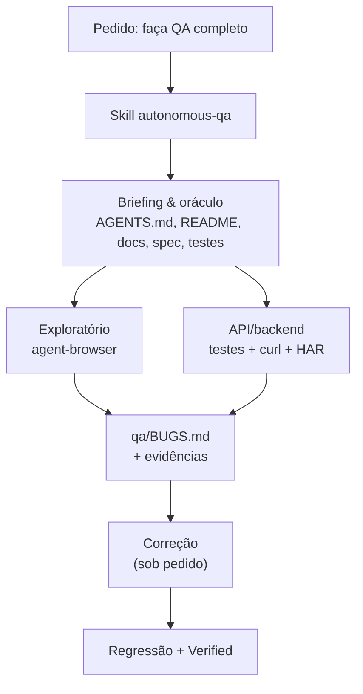

<p align="center">
  
</p>

<p align="center">
  
  
  
  
</p>

<h1 align="center">Autonomous QA Engineer</h1>
<p align="center"><strong>Um modo de trabalho de QA que encontra defeitos com evidência — no DeepSeek Harness e nos Bots do DS Bot.</strong></p>

---

## O problema

Agentes de código costumam fazer "QA" assim:

- clicam em dois botões, veem a tela responder e dizem **"está funcionando"**;
- reportam um bug sem passos de reprodução, sem screenshot e sem dizer qual era o comportamento esperado;
- corrigem o sintoma, não a causa, e não rodam regressão;
- testam o frontend e assumem que o backend está certo.

Este repositório existe para mudar isso.

## A resposta

Três peças, nenhuma ferramenta nova:

| Peça | O que é | Onde vive |
|---|---|---|
| **Skill** `autonomous-qa` | o procedimento completo: briefing, exploração, API, relatório, correção, regressão | `~/.dsh/skills/autonomous-qa/` |
| **Preset** `Autonomous QA Engineer` | a persona e o modo no seletor de sessão do DSH | bundle local, instalado no perfil |
| **Bot** `QA` | o especialista persistente do DS Bot, com pasta e permissões próprias | DS Bot (ds-bot) |

A skill é o núcleo. O preset e o Bot são cascas: o mesmo procedimento roda em uma sessão Web, em uma sessão com o preset ou em um Bot.

## Compatibilidade

| Superfície | Skill | Preset | Bot |
|---|:---:|:---:|:---:|
| DSH Web | ✅ | ✅ | — |
| DSH Desktop | ✅ | ✅ | ✅ |
| DS Bot / Bots (ds-bot) | ✅ | —¹ | ✅ |

¹ Bots do ds-bot são criados com o preset `standard`; eles usam a skill, não o preset.

## Como funciona



O agente só começa a explorar depois de responder: **o que é o app, para quem, quais jornadas importam e o que é "correto" em cada uma**. O resultado esperado sempre tem uma fonte: spec, teste, contrato ou premissa explícita.

## O que vem no pacote

```text
dsh-qa-bot/
├─ skills/autonomous-qa/
│  ├─ SKILL.md                  # o procedimento (6,4 KB)
│  └─ references/
│     ├─ briefing.md            # ordem de leitura + template do briefing
│     ├─ bug-report.md          # template, severidade, status, evidência
│     └─ recon.md               # checklist por stack
├─ preset/
│  ├─ package.json              # bundle local
│  └─ cordis.patch.yml          # preset "Autonomous QA Engineer"
├─ bot/qa-bot.md                # campos e instruções do Bot QA
├─ scripts/smoke.ps1            # valida o agent-browser sem app alvo
├─ install.ps1                  # Windows
├─ install.sh                   # macOS / Linux
├─ docs/architecture.md         # decisões e limites
├─ CHANGELOG.md
└─ LICENSE
```

## Requisitos

- **DeepSeek Harness** `0.2.2-rc.1` ou superior.
- **agent-browser** `0.41` ou superior, com Chrome instalado:

  ```bash
  npm i -g agent-browser
  agent-browser install
  agent-browser doctor
  ```

- **DS Bot** (`ds-bot`) apenas se você quiser o Bot dedicado.

## Instalação

### 1. Clone

```bash
git clone https://github.com/ikauann/dsh-qa-bot.git
cd dsh-qa-bot
```

### 2. Instale a skill

Windows:

```powershell
pwsh -ExecutionPolicy Bypass -File .\install.ps1
```

macOS / Linux:

```bash
chmod +x install.sh
./install.sh
```

O script copia `skills/autonomous-qa/` para `$DSH_HOME/skills/autonomous-qa` (padrão: `~/.dsh/skills/autonomous-qa`). O DSH descobre a skill na hora — não precisa reiniciar.

Confirme em uma sessão nova pedindo:

```text
carregue a skill autonomous-qa
```

### 3. Instale o preset (opcional, mas recomendado)

Com o DSH aberto, peça ao agente:

```text
instale o bundle C:\caminho\para\dsh-qa-bot\preset
```

Ele usa o plugin manager, adiciona o bundle ao perfil e ativa o preset. Depois, crie uma **nova sessão** e escolha **Autonomous QA Engineer** no seletor de modo.

> Em `Settings → Plugins` o bundle aparece como `@ikauann/dsh-qa-preset`. Sessões já abertas continuam no preset antigo; o novo modo vale para sessões novas.
>
> O bundle é instalado como um **link** para esta pasta. Se você mover ou apagar o clone, reinstale o preset.

### 4. Crie o Bot QA (DS Bot)

Siga [`bot/qa-bot.md`](bot/qa-bot.md): nome, papel, instruções, pasta de trabalho, permissão e computer-use. São quatro campos no painel do DS Bot.

## Uso

| Você diz | O agente faz |
|---|---|
| "Faça QA completo neste aplicativo." | contrato → briefing → frontend + backend → `BUGS.md` |
| "Teste o frontend e backend." | idem, sem correção |
| "Explore a aplicação e encontre bugs." | exploratório com `agent-browser` + relatório |
| "Valide esta nova funcionalidade." | fluxo alvo + regressão das áreas tocadas |
| "Corrija os bugs encontrados e execute a regressão." | causa raiz → diff mínimo → repro → regressão → `Verified` |

Exemplo de pedido completo:

```text
Faça QA completo neste aplicativo: http://localhost:3000
Repositório: C:\dev\meu-app
Conta de teste: qa@example.com (senha em .env.local)
Escopo: login, checkout e recuperação de senha.
Não toque em produção. Não altere dados fora do ambiente local.
```

## O que o agente produz

Na raiz do repositório testado:

```text
qa/
├─ context.md        # ambiente, URL, credenciais (redigidas), escopo
├─ briefing.md       # o que é o app, jornadas, resultado esperado + fonte
├─ plan.md           # matriz de cobertura
├─ BUGS.md           # relatório
└─ evidence/
   └─ BUG-001/
      ├─ repro.md
      ├─ before.png
      ├─ console.log
      └─ response.json
```

Exemplo de bug:

```markdown
### BUG-007 — Cupom expirado é aceito no checkout

- **Severidade:** High
- **Categoria:** Backend
- **Status:** Open
- **Confiança:** Confirmado

**Esperado:** rejeitar com 422 e "cupom expirado".
**Fonte:** spec: docs/checkout.md §3.2

**Atual:** pedido é criado com 10% de desconto.

**Evidência:** qa/evidence/BUG-007/ (before.png, response.json)
**Causa provável:** validação de data só no cliente — src/checkout/coupon.ts:42
```

## Regras que a skill impõe

1. **Evidência ou não aconteceu** — bug sem repro e sem arquivo não é bug confirmado.
2. **"Esperado" tem fonte** — `spec:`, `teste:`, `contrato:` ou `premissa:`.
3. **Não invente** comando, endpoint, seletor ou regra.
4. **Não destrua** — produção é somente leitura; mutação exige autorização.
5. **Não vaze** — credenciais, cookies e dados pessoais ficam fora do relatório.
6. **Não declare 100%** — o relatório lista o que não foi testado.
7. **Diff mínimo** — corrige a causa, não refatora de carona.

## Solução de problemas

**A skill não aparece no catálogo**

- Confirme o caminho: `~/.dsh/skills/autonomous-qa/SKILL.md` (ou `%USERPROFILE%\.dsh\skills\...`).
- Confirme o frontmatter: `name: autonomous-qa` e `description:` preenchida.
- Abra uma sessão nova; o catálogo é montado no início da sessão.

**O preset não aparece no seletor**

- Veja `Settings → Plugins`: o bundle `@ikauann/dsh-qa-preset` precisa estar ativo.
- Verifique a linha `preset-qa` na lista de plugins do perfil.
- Sessões antigas mantêm o preset com que nasceram; crie uma nova.

**`read_browser` não existe no DSH Web**

Correto. No Web não há painel de navegador nem `read_browser`. A skill usa o `agent-browser` pelo shell. O painel de navegador do DS Bot é do DSH Desktop.

**computer-use não funciona no Web**

O provedor `@deepseek-ai/dsh-computer-use` não vem instalado no perfil Web e o bundle oficial está marcado como `unsupported-platform`. A aba pode aparecer, mas as ferramentas só montam quando o provedor existe (DSH Desktop). O QA web não depende disso.

**`agent-browser` não abre**

```bash
agent-browser doctor
agent-browser install
```

No Windows, rode o PowerShell com `-ExecutionPolicy Bypass` se o script for bloqueado.

## Estrutura do repositório

| Caminho | Papel |
|---|---|
| `skills/autonomous-qa/SKILL.md` | procedimento que o modelo carrega |
| `skills/autonomous-qa/references/` | material sob demanda (briefing, relatório, recon) |
| `preset/cordis.patch.yml` | declaração do preset `qa` |
| `bot/qa-bot.md` | setup do Bot dedicado |
| `scripts/smoke.ps1` | teste do toolchain, sem app alvo |
| `install.ps1` / `install.sh` | instalação da skill |
| `docs/architecture.md` | por que skill, preset e Bot (e por que não MCP) |

## Desenvolvimento

Valide o toolchain sem precisar de uma aplicação:

```powershell
pwsh -File .\scripts\smoke.ps1
```

O script abre uma fixture local, preenche um campo, clica, verifica o texto e salva `scripts/.artifacts/smoke.png`.

## Licença

[MIT](LICENSE) © 2026 Kauan (ikauann)
